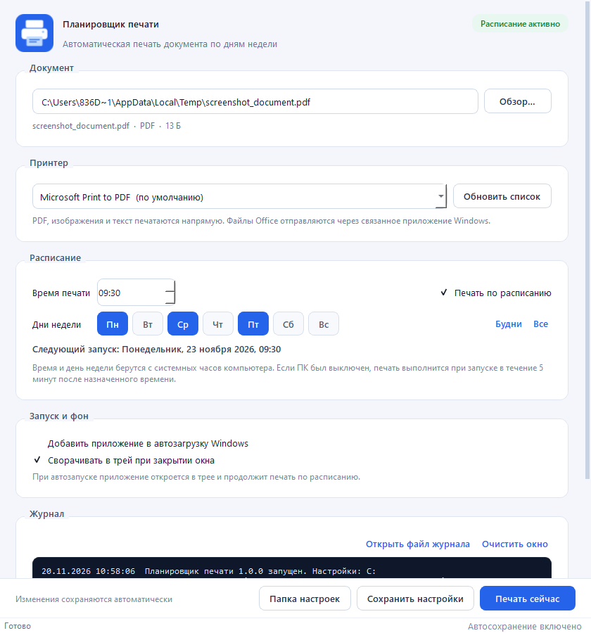

# Планировщик печати


Приложение для Windows на Python + PyQt6. Выбирает документ и принтер и
автоматически отправляет документ на печать в заданное время в выбранные дни
недели. Время и дата берутся с системных часов компьютера.

## Скриншот



## Возможности

- выбор документа через проводник;
- перетаскивание документа прямо в окно приложения;
- список всех доступных принтеров с отметкой принтера по умолчанию;
- еженедельное расписание: время и любая комбинация дней недели;
- печать в фоне, в том числе когда окно свёрнуто в системный трей;
- автоматическая загрузка Windows через `HKCU\...\Run` и запуск в трее;
- сохранение документа, принтера, времени, дней и других настроек;
- журнал событий в окне и в файле;
- один экземпляр приложения, чтобы расписание не сработало дважды;
- ручная печать кнопкой «Печать сейчас».

При закрытии окна приложение по умолчанию сворачивается в трей. Полный выход —
через меню значка в трее.

## Установка и запуск

Требуется Windows 10/11 и Python 3.10 или новее.

Склонируйте проект или распакуйте архив в удобную папку. В примерах ниже
используется общий путь `C:\Users\User\...` — замените `User` на имя своей
учётной записи либо используйте переменную `%USERPROFILE%`.

```powershell
cd $env:USERPROFILE\Desktop\projects\strynik
python -m pip install -r requirements.txt
python main.py
```

Если папка проекта находится в другом месте, путь нужно изменить, например:

```powershell
cd C:\Users\User\Desktop\projects\strynik
```

Можно запустить `run.bat` — приложение откроется без консольного окна.

При первом запуске:

1. Нажмите «Обзор…» и выберите документ.
2. Выберите принтер.
3. Отметьте дни недели и задайте время.
4. Включите «Печать по расписанию».
5. При необходимости включите «Добавить приложение в автозагрузку Windows».

Настройки сохраняются автоматически. Кнопка «Сохранить настройки»
дополнительно фиксирует их сразу и показывает подтверждение.

## Как работает расписание

- Используется локальное время компьютера.
- Расписание повторяется каждую неделю в выбранные дни.
- Приложение проверяет время каждые 10 секунд.
- Если компьютер был выключен или спал, печать выполнится при запуске
  приложения в течение 5 минут после назначенного времени.
- Один выбранный день печатается не более одного раза.
- Для фоновой печати приложение должно быть запущено. Включите автозагрузку
  и оставляйте приложение в трее.

## Поддерживаемые документы

Напрямую через Qt/PyMuPDF печатаются:

- PDF;
- изображения PNG, JPEG, BMP, GIF, TIFF, WEBP;
- текст TXT, LOG, CSV, INI, CFG, CONF;
- HTML и Markdown.

Файлы Office и другие форматы отправляются в связанное приложение Windows
через системную команду `PrintTo` (например, Word, Excel или приложение PDF,
если PyMuPDF не установлен). Для таких файлов в системе должно быть
установлено приложение, умеющее открывать этот формат и поддерживающее
печать. Завершение задания в этом случае контролирует стороннее приложение.
Если связанного приложения нет, приложение покажет ошибку в журнале.

## Автозагрузка

Команда автозапуска записывается в реестр текущего пользователя:

```text
HKEY_CURRENT_USER\Software\Microsoft\Windows\CurrentVersion\Run
```

Значение имеет имя `PrintScheduler`, запускается с ключом `--minimized`.
Для запуска из исходников используется `pythonw.exe` и путь к `main.py`.
Для собранного `.exe` — путь к самому `.exe`.

Если переместить папку с приложением, запустите его один раз: путь в
автозагрузке обновится автоматически.

## Где хранятся настройки

```text
%APPDATA%\PrintScheduler\settings.json
%APPDATA%\PrintScheduler\app.log
```

Путь к папке можно открыть кнопкой «Папка настроек». Журнал также
открывается из блока «Журнал».

Пример сохранённого файла:

```json
{
  "document_path": "C:\\Users\\User\\Documents\\отчёт.pdf",
  "printer_name": "HP LaserJet",
  "weekdays": [0, 2, 4],
  "print_time": "09:30",
  "enabled": true,
  "autostart": true,
  "minimize_to_tray": true,
  "last_triggered_date": "2026-11-20"
}
```

## Сборка EXE

Установите зависимости и PyInstaller, затем запустите:

```text
build_exe.bat
```

Готовый файл: `dist\PrintScheduler.exe`. После перехода с исходников на EXE
включите автозагрузку повторно или запустите приложение один раз — путь в
реестре синхронизируется.

## Проверка

Установите зависимости, затем запустите тесты:

```powershell
python -m unittest discover -s tests -v
```

Тесты не печатают на реальный принтер. Проверяются расчёт расписания,
нормализация настроек, чтение текстовых файлов в разных кодировках и
подготовка документов (текст, Markdown, HTML, изображения, PDF) — результат
рендеринга сохраняется в тестовый PDF-файл.
